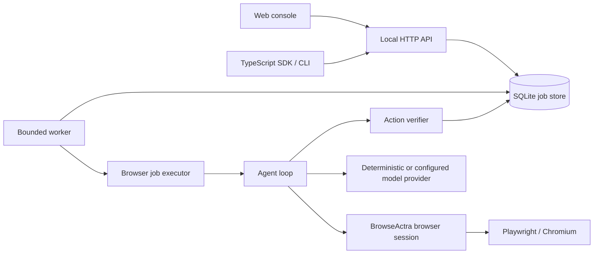

# Architecture

BrowseActra's new application is a TypeScript modular monolith. An HTTP API, job store, worker, agent, browser session, verifier, SDK, CLI, and static web console live in one repository. The local path uses Playwright as a browser driver and SQLite for job state. The imported Stagehand SDKs remain in the repository for compatibility reference but are not the browser engine for the new application path.

## Owned modules

| Module                          | Current responsibility                                                                                                                  |
| ------------------------------- | --------------------------------------------------------------------------------------------------------------------------------------- |
| `packages/browseactra-runtime`  | Typed browser abstraction, Playwright-backed session lifecycle, bounded observations, agent loop, provider adapters, and action policy. |
| `packages/browseactra-verifier` | Independent precondition/postcondition checks and bounded, redacted action receipts.                                                    |
| `packages/browseactra-executor` | Connects jobs to browser sessions, providers, policy, verification, and persisted receipts.                                             |
| `apps/api`                      | HTTP validation and authentication, SQLite job/events/receipts store, worker claiming, leases, cancellation, and static UI delivery.    |
| `packages/browseactra-sdk`      | Typed client for the versioned job API.                                                                                                 |
| `packages/browseactra-cli`      | Commands that call the local API and start local development.                                                                           |
| `apps/web`                      | Static HTML/CSS/JavaScript console that reads real API responses.                                                                       |

The API and worker share a database in the first deployment. A worker claims a queued job, owns it under a lease token, runs the agent, writes events and receipts, and commits an outcome if it still owns the lease. See [system design](SYSTEM_DESIGN.md) for the recovery boundary.

## Request path

1. A client submits an instruction and starting URL to `POST /api/v1/jobs`.
2. The API validates and stores a queued job. A supplied idempotency key deduplicates identical submissions.
3. The worker claims a job with a lease and opens an isolated browser session.
4. The agent observes the page, receives one typed decision from a provider, checks trusted action policy, executes, and verifies browser state.
5. The worker stores event and receipt records, then commits a terminal status and structured result.
6. The API, SDK, CLI, and UI read the same persisted job state.

Webpage text is untrusted input to the model provider. Model output is a proposal, never authorization. The browser abstraction bounds observations and the policy controls actions. A browser disconnect or uncertain side effect becomes an indeterminate outcome instead of an automatic replay.

## Retained foundation

The Stagehand-derived protocol, extension, SDKs, integrations, CLI, docs, and evaluation harness remain under their original package paths. Their internal identifiers and licenses remain intact while they are still present. The new application path uses `@browseactra/*` modules rather than importing the inherited SDK. See [UPSTREAM.md](../UPSTREAM.md) for exact source revision and ownership, and the [roadmap](ENGINEERING_ROADMAP.md) for replacement work that is still planned.
