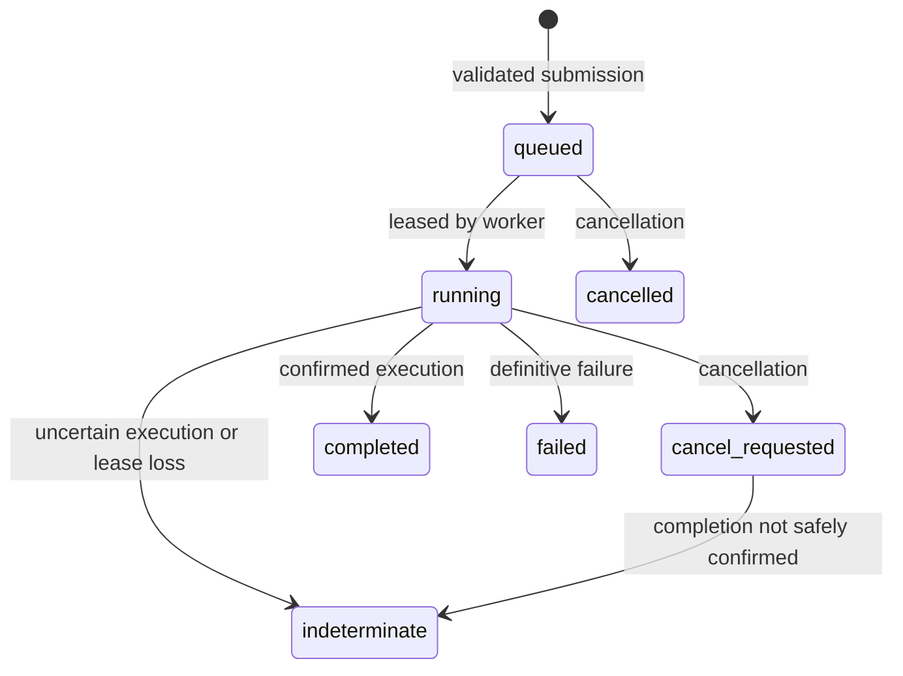

# Job and execution design

This document describes the current BrowseActra job execution model in `apps/api`. It is a durable **job** ledger with action receipts. It is not yet a general-purpose workflow engine with serializable step checkpoints or automatic continuation across a browser restart.

## State model

The job store writes transitions and events in SQLite transactions. `queued` jobs can be claimed once at a time. The worker records the claim owner, lease expiry, and increasing fencing token. Heartbeats extend only the currently owned lease. Event and receipt writes check the token and lease; a stale worker cannot overwrite the current state.

## Submission and idempotency

The API accepts a bounded instruction and HTTP(S) URL. An optional `Idempotency-Key` request header is stored with the job. A repeat with the same input returns the existing job; reuse with different input is a conflict. This prevents duplicate **submissions**. It does not guarantee exactly-once effects on an external website.

## Agent execution

The worker opens a browser session for the job and passes it to an agent. The agent observes a bounded page snapshot, asks a deterministic or configured model provider for one typed action, applies trusted policy, executes once, and independently checks its outcome. An action can be `verified`, `rejected`, or `indeterminate`. The worker persists an event and receipt for observable progress.

The default policy permits read-oriented navigation and text inspection. More sensitive actions require an explicitly configured policy. An uncertain action is never automatically replayed merely because a request timed out.

## Failure and cancellation

Cancellation of a queued job is immediate. Cancellation of a running job requests abort and closes owned browser resources. If completion cannot be confirmed within the grace period, the job becomes `indeterminate`. A worker crash or expired lease also leaves running work `indeterminate`; a new worker does not assume the browser side effect failed.

These rules favor correctness over unattended retries. Human or application-specific reconciliation is still needed for uncertain side effects. The job ledger records the uncertainty but does not yet resume a multi-step workflow from a safe checkpoint.

## Persistence boundary

SQLite stores jobs, events, and receipts in the configured local database. WAL mode is enabled for file-backed databases. The API applies size and output limits; stored receipt metadata is redacted and bounded. The database file is local state, not a secret vault or multi-tenant production store. Backups, schema migration tooling, and PostgreSQL support remain future work.

See [ADR 0001](DECISIONS/0001-modular-monolith-and-uncertain-actions.md) for the trade-off and [security](SECURITY.md) for target and credential controls.
